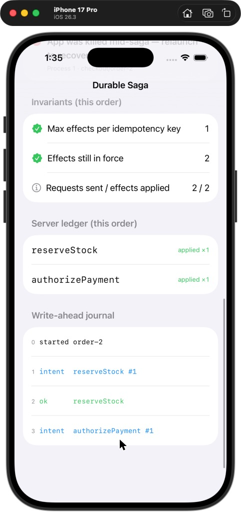
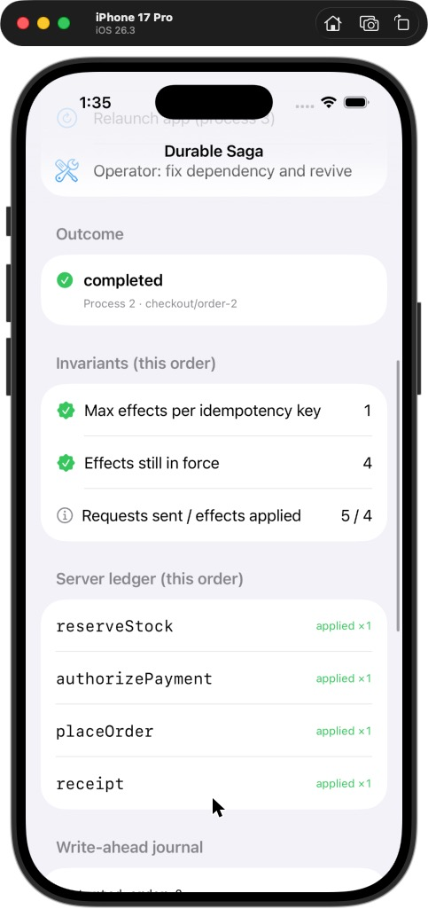
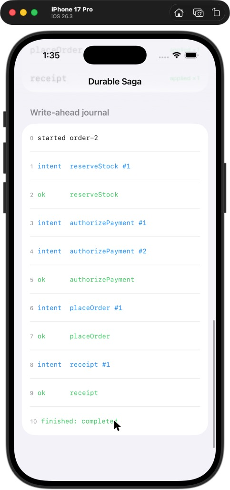
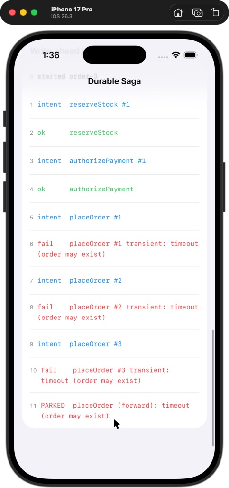
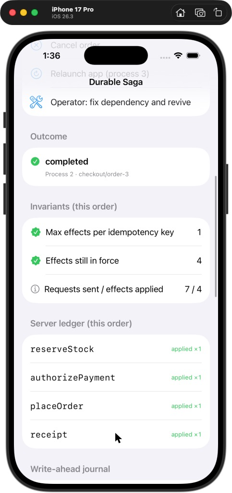

# Durable Saga — Demo App

**Kill the app between "card authorized" and "order placed". Relaunch. Watch it finish the order without charging twice.**

This is the companion iOS app for [**durable-saga-kit**](https://github.com/rajatslakhina/durable-saga-kit), a Swift 6 library that runs multi-step client workflows (here: reserve stock → authorize payment → place order → send receipt) as crash-safe sagas over a write-ahead journal. The app is a lab bench: pick a failure, place an order, and read the journal and the server ledger side by side as the saga rolls back, parks, or recovers.

## Why this matters

Every app with a checkout, a booking, or an upload-then-commit flow has this bug somewhere: a multi-step operation written as one `async` function that assumes the process lives until the end. It does not. This app makes each failure mode visible and shows the rule that handles it:

| Scenario toggle | What you see | The rule it demonstrates |
|---|---|---|
| *(none)* | 4 intents, 4 successes, `completed` | Each intent is journaled before its request goes out |
| **Card is declined** | `rollback begins` → `undo authorizePayment` → `undo reserveStock` | Before the pivot, failure rolls back in reverse order, and every *attempted* step is undone |
| **Place-order responses get lost** | 3 timeouts → `PARKED placeOrder`. Then **Revive** → `completed`, and the ledger shows `placeOrder applied ×1` | A lost pivot response is ambiguous. The saga parks instead of guessing, and the retry reuses the idempotency key. Tapping **Cancel** during the timeouts does *not* roll back: the order may exist, so the cancel is resolved forward and reported as ignored |
| **Receipt mail service is down** | order placed, receipt parked | After the pivot the saga only moves forward. It never voids a placed order |
| **Kill the app after the payment hold** | status: *App was killed mid-saga*. Then **Relaunch** → process 2 resumes from the journal | The in-doubt step is re-executed with the same key. The server dedupes it, and "Max effects per idempotency key" stays at 1 |
| **Cancel order** (while running) | before `placeOrder` is attempted: `cancel requested` → rollback. Once it has been attempted: the saga finishes, with "cancel arrived after the order was attempted" | Cancellation is a journaled request, not an interrupt. Once the order may exist, a cancel cannot void the payment |

The **Invariants** section is computed live from the fake server's ledger for the *current order*: "Max effects per idempotency key" is the maximum `appliedCount` over that order's keys, and "Effects still in force" must be 0 after a rollback. "Requests sent / effects applied" is shown as information (more requests than effects is the point: retries and recovery reuse keys).

## Screenshots

These are real captures of the app running on an **iPhone 17 Pro Simulator (iOS 26.3)**, built and launched from Xcode 26.3 on 15 Oct 2026. The mouse pointer is visible in some of them because the Simulator was driven with clicks.

**The headline scenario: the app is killed after the payment hold, then relaunched.**

| Killed mid-saga | After relaunch | The journal tells the story |
|---|---|---|
|  |  |  |
| The journal stops at `intent authorizePayment #1`: the effect is **in doubt**. The server ledger shows that the hold did land. | Process 2 resumed from the journal and finished. 5 requests reached the server, but only 4 effects were applied: **max 1 per idempotency key**. | Attempt #2 of `authorizePayment` reused the same key, so the server returned the existing hold instead of placing a second one. |

**A lost "place order" response: park, then revive.**

| Parked at the pivot | Revived and completed |
|---|---|
|  |  |
| Three timeouts, and the order may exist, so the saga **parks forward** instead of voiding the payment. | The operator revives it. The pivot is retried with the same key, and `placeOrder` is applied ×1. |

## How to run it

1. `git clone https://github.com/rajatslakhina/durable-saga-demo-app.git`
2. Open `Demo.xcodeproj` in Xcode 16 or later.
3. Xcode resolves **durable-saga-kit** from GitHub. It is a remote Swift package with the requirement *Up to Next Major Version* from `1.0.0`. The committed `Package.resolved` locks it to the exact `v1.0.0` commit until you choose to update.
4. Select the **Demo** scheme and any iOS 16+ Simulator, then Build & Run (⌘R). The screenshots above came from exactly this: Xcode 26.3, iPhone 17 Pro Simulator, iOS 26.3.
5. Toggle a failure scenario, tap **Place order**, and follow the journal.

## How it is put together

- `Demo/DemoApp.swift`: the `@main` entry point. It owns a `CheckoutLab`.
- `Demo/CheckoutLab.swift`: the app's configuration (`DemoConfiguration`: saga definition, retry policy, simulated latency), a `DemoServer` actor that deduplicates on idempotency keys and injects faults, and the view model that drives the library's `SagaCoordinator` over an `InMemoryJournal`. "Relaunch" builds a **new** coordinator over the same journal and calls `resumeAll()`. That is the same code path a real cold launch takes.
- `Demo/ContentView.swift`: SwiftUI. It shows scenario toggles, controls, outcome, invariants, the server ledger and the journal.

The app uses `InMemoryJournal` so that each launch starts clean. "Kill" retires the coordinator: it stops its drive tasks and refuses further writes. "Relaunch" starts a successor over the same journal, which takes a newer epoch, so even a write that slipped past the retirement would be rejected by the journal. A production app would use the library's `FileJournal`.

## Design decisions

- **Simulate process death in-process, not with a real kill.** A real `exit(0)` would demonstrate nothing visible: the journal is in memory and the UI would vanish. Retiring the coordinator mid-step (from a hook that runs *after* the server applied the payment hold) recreates the exact state a crash leaves: an intent with no outcome. The successor then recovers it through the same `resumeAll()` a cold launch uses. *Trade-off:* it does not exercise `FileJournal`'s torn-tail repair. The library's tests do, against real files.
- **A fake server with key-level dedupe and injected faults, not mocks of the coordinator.** The interesting behaviour happens at the boundary: a lost response after an applied effect, a permanent decline, a dependency that is down. The fake server models those and nothing else, so everything the screen shows comes from the real library.
- **Poll the journal at ~8 Hz instead of streaming events.** An `AsyncStream` of journal appends would need a new public API in the library just for a demo. Polling a 20-record journal costs nothing and keeps the library surface honest. *Rejected:* adding an observer hook to `SagaCoordinator`, which would leak UI concerns into the engine.
- **Scope the ledger and invariants to the current order.** The server keeps every order's effects. The invariants are judged per order, because "a rollback left nothing in force" is a statement about one saga.
- **Faults are snapshotted when a run starts.** The toggles are disabled while a saga runs, and **Revive** clears the "lost responses" and "mail down" faults, playing the operator who fixed the dependency.

## Verification

Exactly what has and has not been verified:

- **Simulator run: done (15 Oct 2026).** The app was opened from a fresh download of this repo in Xcode 26.3. Xcode resolved `durable-saga-kit` `1.0.0` from GitHub, built the app, and launched it on an iPhone 17 Pro Simulator (iOS 26.3). As it launched, the debugger briefly showed the main thread paused inside UIKit, although no breakpoints were set. A few seconds later Xcode reported *Running*, and I did not press Continue. The app was then exercised by hand through three scenarios, all with the outcomes the table above describes:
  - the happy path: completed, 10 journal records
  - kill after the payment hold, then relaunch: completed by process 2, 5 requests and 4 effects, max 1 per key
  - lost place-order responses, then park, then revive: completed, `placeOrder` applied ×1 after 4 requests
- **Screenshots:** six captures, five of them embedded above (`Demo/Screenshots/`).
- **Not done:** the decline and cancel scenarios were not exercised on the Simulator. They are covered by the headless tests below.
- **View-model logic, exercised headlessly (local, Linux, Swift 6.0.3):** `CheckoutLab.swift`, byte-identical to the shipped file, was compiled against the library with a small stand-in for Combine's `ObservableObject`/`@Published`. It was then driven through 7 scenario tests: the happy path, a decline rolling back to zero live effects, lost pivot responses → park → revive → `placeOrder applied ×1`, kill → relaunch → completed with one effect per key, cancel before the pivot → rollback, cancel during lost pivot responses → no rollback, and invariants scoped to the current order. 7/7 passed. `ContentView.swift` and `DemoApp.swift` (SwiftUI) cannot compile on Linux. They were compiled first by CI, then by the Xcode 26.3 run above.
- **`Demo.xcodeproj`:** written by hand. Braces and parentheses balance, every one of its 24 object ids is defined, the shared scheme points at the `Demo` target, and a third-party `pbxproj` parser loads it.
- **CI** ([Actions](https://github.com/rajatslakhina/durable-saga-demo-app/actions)): one `macos-15` job on Xcode 16.4.
  - It runs `xcodebuild -resolvePackageDependencies`, which fetches `durable-saga-kit` from GitHub and checks out `1.0.0`.
  - It then builds the `Demo` scheme for `generic/platform=iOS Simulator`: `** BUILD SUCCEEDED **`, with 0 Swift warnings and 0 errors.
  - The job compiles the app and does not run it. The run is the Simulator item above.
- **Independent quality gate:** a fresh Opus reviewer graded both repos in each of 3 rounds, the maximum this pipeline allows.
  - Round 1 failed them. It found 2 blockers, the main one being that a cancel during the order's retry backoff voided the payment on an order that might exist. The reviewer reproduced it in this app. It also found 6 major issues.
  - Round 2 failed them on 1 major issue: a failure the server had definitively declined was retried after a crash. It also found documentation gaps.
  - Round 3 failed them on 1 major issue: overlapping journal prunes could self-deadlock. It also found minor issues.
  - Every item was fixed and pinned by a test. **The round-3 fixes were not independently re-reviewed.**

## License

MIT
